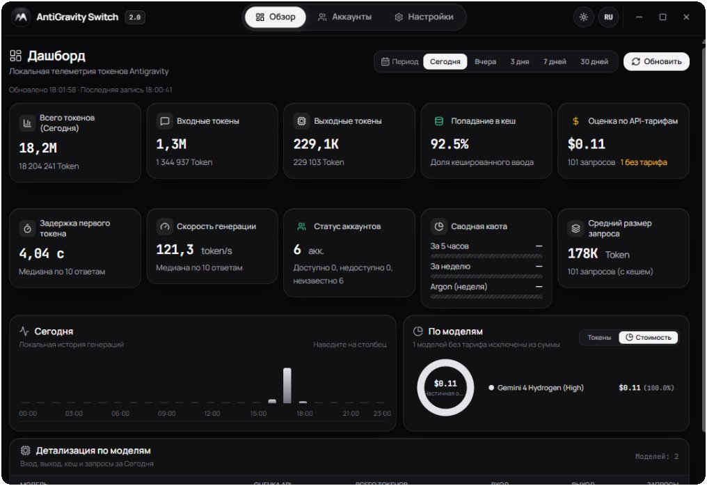
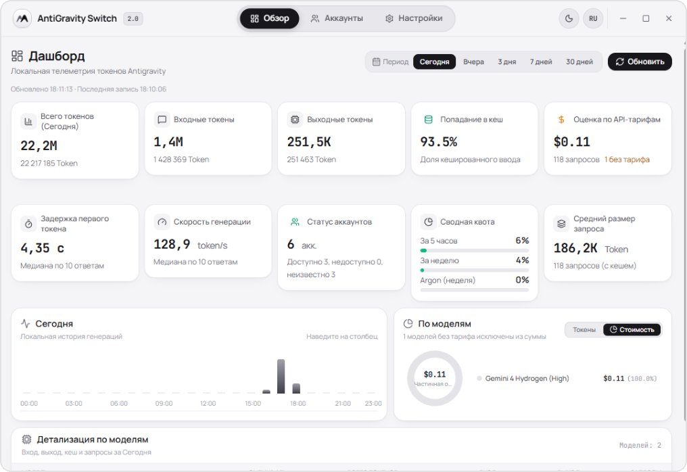

<div align="center">
  <picture>
    <source media="(prefers-color-scheme: light)" srcset="branding/app-icon-light.png" />
    <source media="(prefers-color-scheme: dark)" srcset="branding/app-icon.png" />
    
  </picture>
  <h1>AntiGravity Switch</h1>
  <p>Десктопный и консольный менеджер аккаунтов Antigravity с мониторингом квот, локальной телеметрией и быстрым переключением.</p>
  <p>
    <a href="https://github.com/velqor1/antigravity-switch/releases/latest"><strong>Скачать Release v1.0</strong></a>
    ·
    <a href="#интерфейс">Интерфейс</a>
    ·
    <a href="#возможности">Возможности</a>
    ·
    <a href="#установка-windows">Установка</a>
    ·
    <a href="#сборка-из-исходников">Сборка</a>
  </p>
</div>

## Интерфейс

<table>
  <tr>
    <td width="50%" align="center">
      
      <br />
      <sub><strong>Тёмная тема</strong> · графитовый монохром и светлый знак</sub>
    </td>
    <td width="50%" align="center">
      
      <br />
      <sub><strong>Светлая тема</strong> · чистый светлый фон и тёмный знак</sub>
    </td>
  </tr>
</table>

## Возможности

- **Управление аккаунтами** — добавление через Google OAuth, refresh-токен или локальный импорт, заметки, перетаскивание порядка, отключение и экспорт/перенос профилей.
- **Актуальные квоты и аналитика** — остаток и время сброса по окнам `5H` и `Weekly` для актуальных моделей (`Gemini 4 Neon`, `Gemini 4 Hydrogen`, `Gemini 4 Argon`, `Gemini 4 Carbon`, `Claude Opus 5.5`, `Claude Sonnet 5.5`, `Gemini 3.8 Flash`, `GPT-OSS 120B`), локальная телеметрия токенов, журнал циклов и оценка расхода.
- **Быстрое и автоматическое переключение** — смена активного аккаунта в один клик для Antigravity Desktop App, CLI (`agy`), IDE и расширения VS Code, плюс опциональное автопереключение при падении квоты.
- **Адаптивный интерфейс и иконка** — тёмная и светлая монохромные темы, собственная безрамочная шапка окна, пружинные анимации, динамическая иконка приложения и трея под активную тему, локализация (`RU` / `EN` / `ZH`) и мини-панель в трее.
- **Консольный клиент** — утилита `agy-switch.exe` для работы из терминала с той же локальной базой аккаунтов.

## Установка (Windows)

1. Откройте **[Releases](https://github.com/velqor1/antigravity-switch/releases/latest)** и скачайте `agy-switch-v1.0-windows-x64.zip`.
2. Распакуйте в удобную папку и запустите `agy-switch-desktop.exe` (для терминала — `agy-switch.exe`).

> Аккаунты и настройки хранятся только локально в `%USERPROFILE%\.antigravity_tools\`.

## Стек

- **Desktop / Backend:** Tauri v2, Rust
- **Frontend:** React, TypeScript, Tailwind CSS, Motion (`motion/react`), Zustand, i18next

## Сборка из исходников

Требования: **Node.js 20+**, **Rust (MSVC на Windows)**, **Visual Studio Build Tools 2022**, **LLVM (`LIBCLANG_PATH`)**.

Для встроенного Google OAuth при сборке из исходников задайте переменные окружения `ANTIGRAVITY_OAUTH_CLIENT_ID` и `ANTIGRAVITY_OAUTH_CLIENT_SECRET` (или передайте их во время запуска).

```bash
npm install
npm run build
npm run tauri build -- --no-bundle -- --locked
```

Готовые бинарники появятся в `src-tauri/target/release/`:
- `agy-switch-desktop.exe` — графическое приложение
- `agy-switch.exe` — консольный интерфейс

## Основа и лицензия

Основан на [anglee0323/agy-switch](https://github.com/anglee0323/agy-switch). Доработано:
- переработан интерфейс в тёмном и светлом монохроме с плавными анимациями;
- добавлена собственная безрамочная верхняя панель окна для Windows;
- создана новая иконка **Twin Peaks** с автоматической сменой под тему в шапке, на панели задач и в трее;
- добавлена полная русская локализация и обновлён набор отслеживаемых моделей по умолчанию.

Распространяется под лицензией **[CC BY-NC-SA 4.0](LICENSE)**.
